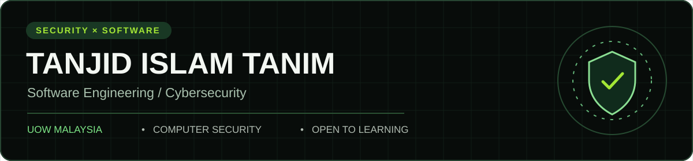

### Software Engineering Student · Computer Security Specialization

**University of Wollongong Malaysia** · Expected graduation: **September 2027**

## 01 / About

I'm a **Bachelor of Software Engineering (Hons)** student at **University of Wollongong Malaysia**, specializing in **Computer Security**. I enjoy exploring how applications work, where security weaknesses emerge, and how to design and test more reliable software.

- **Current focus:** Application security, SQL injection testing, secure software development
- **Hands-on experience:** Authentication, databases, backend integration, testing and debugging
- **Career direction:** Cybersecurity / IT Security specialist

## 02 / Tech Stack & Skills

**Programming & databases**

**Tools & practices**

`SQL Injection Testing` · `Authentication` · `Input Validation` · `Database Design` · `Software Design Patterns` · `Testing & Debugging`

## 03 / Featured Projects

<table>
<tr><td width="50%" valign="top">

### 🛡️ [SQLShield](https://github.com/TanjidIslamTanim/sqlshield-sqli-lab)
**SQL Injection Security Lab**

Exploring SQL injection vulnerabilities, controlled testing, and defensive techniques.

`Application Security` `SQL` `Testing`

</td><td width="50%" valign="top">

### 💻 [CollabSphere LMS](https://github.com/TanjidIslamTanim/CollabSphere-LMS)
**Learning Management System**

Worked on authentication, PHP backend, SQL database design, input validation, UI and debugging.

`PHP` `SQL` `Authentication`

</td></tr>
<tr><td width="50%" valign="top">

### 🏥 [Smart Healthcare](https://github.com/TanjidIslamTanim/Smart-Healthcare-Appointment-System)
**Appointment Management System**

Integrated and tested role-based workflows with Factory, Observer and Strategy patterns.

`Software Design` `Testing`

</td><td width="50%" valign="top">

### 🔔 [Hotel Booking Notifications](https://github.com/TanjidIslamTanim/hotel-booking-notification-service)
**Notification Service**

A software project focused on hotel booking notifications.

`Software Engineering`

</td></tr>
</table>

**Also built:** [Bakery Management System](https://github.com/TanjidIslamTanim/Bakery-Management-System) · [Explore all repositories](https://github.com/TanjidIslamTanim?tab=repositories)

## 04 / GitHub Activity

[**View live GitHub contributions →**](https://github.com/TanjidIslamTanim?tab=overview)

> The graph is provided by a third-party service and may occasionally be unavailable. GitHub's own contribution calendar appears below the profile README.

## 05 / Training & Career Goals

**Deloitte Australia — Cyber Job Simulation (completed)**  
Reviewed a security scenario, analyzed data, identified risks, and investigated an incident.

I'm working toward a career in **Cybersecurity / IT Security**, developing practical skills through security labs and software engineering projects.

---

**Let's connect**

[LinkedIn](https://www.linkedin.com/in/tanjid-tanim/) · [GitHub](https://github.com/TanjidIslamTanim) · [Repositories](https://github.com/TanjidIslamTanim?tab=repositories)

Secure software starts with thoughtful engineering.

